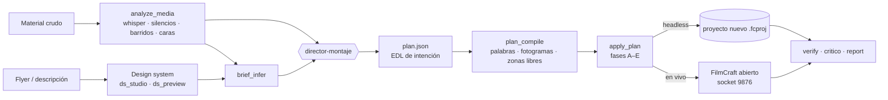

<p align="center">
  
</p>

<p align="center">
  <b>Plugin de Claude Code que monta videos en <a href="https://github.com/storytold/filmcraft">FilmCraft</a> a partir de un design system de video y un brief de intenciones.</b><br>
  Solo (headless, de punta a punta) o contigo al lado (asistido, puerta a puerta en la app).
</p>

<p align="center">
  
  
  
  
</p>

---

## Qué hace

Le das una carpeta con el material crudo de un evento (videos, voz procesada, fotos y flyer). El plugin:

1. **Escucha y mira** el material: transcribe palabra por palabra con whisper.cpp, mide silencios y energía, detecta los barridos de cámara y localiza caras y personas con Apple Vision. Todo queda en caché.
2. **Elige o crea el estilo**, un *design system de video* (paleta, tipografías, roles de texto, animaciones, transiciones, SFX, música y grade). Lo puede sacar de un flyer por k-means o de una descripción, con vista previa y un ciclo de aprobación.
3. **Completa el brief**: objetivo, público, duración, tono, obligatorios y CTA. Cada campo lleva su origen y su confianza.
4. **Escribe un `plan.json`**, una EDL de *intención* en segundos de la fuente y por roles. Lo hace un subagente director a partir de los momentos que encuentra un subagente analista.
5. **Compila el plan de forma determinista**:
   - bordes ajustados a límite de palabra;
   - tiempos exactos de fotograma;
   - pop-ups colocados en **zonas libres** que no tapan a la gente;
   - subtítulos, barra de marca, SFX ligados a eventos, música con ducking y limitador en el máster.
6. **Lo aplica a FilmCraft** por fases: cortes, audio, textos, transiciones y grade. En headless trabaja sobre un proyecto nuevo; en vivo, por el canal de control de la app abierta.
7. **Verifica antes de enseñar**:
   - hojas de fotogramas con textos y sin ellos, con las caras detectadas;
   - keyframes y cortes en palabra;
   - loudness y pico de la mezcla `.wav`.

   Después pasa un **crítico** y escribe un `informe.md`.

No exporta video salvo que se lo pidas.

## Resultado real

Prueba headless con el material del **#RetoCertEAN · Sesión 5** (AWS Student Builder Group, Universidad EAN). Son 9 grabaciones 4K de un Pixel 8 Pro, comparadas con el reel que se montó a mano:

| | Automático | Manual |
|---|---|---|
| Duración | 53,6 s | 56,7 s |
| Cortes | 23 | 22 |
| Loudness | −14,5 LUFS | −14,7 LUFS |
| Pico | −1,5 dBFS | −0,1 dBFS |
| Obligatorios cubiertos | 5/5 | 5/5 |

- Ningún corte cae dentro de una palabra.
- Los 241 keyframes están dentro de su rango.
- De 22 pop-ups, ninguno tapa una cara.

Compilar y aplicar el plan tarda unos 4 s; la verificación, menos de 1 min. El veredicto del crítico fue *publicable con arreglos*.

<p align="center">
  
  <br><sub>Vista previa del DS precargado <code>sbg-brutalista-s5</code>: maquetas PIL, dos renders reales de FilmCraft, el flyer de referencia y la paleta con sus contrastes.</sub>
</p>

## Cómo funciona



Un solo motor (`scripts/fcengine.py`) sirve para los dos modos. En headless es una sesión persistente de `filmcraft-cli mcp` que devuelve los ids entre comandos. En vivo usa el canal de control JSON por líneas de la app.

## Instalación

Requisitos (macOS):

- [FilmCraft](https://github.com/storytold/filmcraft) 0.8 o superior, con `filmcraft-cli` en `~/.local/bin/`.
- `ffmpeg` y `whisper-cpp` (`brew install ffmpeg whisper-cpp`), más un modelo ggml. Por defecto se usa `ggml-medium.bin`; indica otro con `FILMCRAFT_WHISPER_MODEL`.
- Python 3.11+ con `pillow`, `numpy` y `opencv-python`.
- Xcode Command Line Tools, para compilar `swiftc` y el detector de caras de Apple Vision; no descarga modelos.
- Las fuentes del DS que uses (el precargado pide IosevkaTerm Nerd Font Mono y Menlo).

En Claude Code:

```text
/plugin marketplace add juan52878911/filmcraft-studio
/plugin install filmcraft-studio@juan-local
```

O desde la terminal, con un clon local:

```bash
claude plugin marketplace add ./filmcraft-studio
claude plugin install filmcraft-studio@juan-local --scope user
```

## Uso

| Comando | Para qué |
|---|---|
| `/filmcraft-studio:editar <carpeta>` | **Entrada principal.** Pregunta qué quieres ver y sigue el orden estilo → intenciones → edición (asistida o automática) |
| `/filmcraft-studio:montar <carpeta> --modo headless` | De punta a punta y sin preguntas. Termina con `informe.md` |
| `/filmcraft-studio:montar <carpeta> --modo asistido` | En la app abierta, con puertas: G1 estilo, G2 brief, G3 estrategia, G4 cada bloque en vivo |
| `/filmcraft-studio:ds-crear <descripción o flyer>` | Crea un design system con vista previa y ciclo de aprobar o modificar |
| `/filmcraft-studio:ds-listar` | Catálogo de estilos con miniaturas |
| `/filmcraft-studio:analizar`, `brief`, `verificar`, `nota`, `entregar` | Pasos sueltos: análisis, brief, verificación, aplicar una nota y exportar (solo si lo pides) |

También vale pedirlo en lenguaje natural, por ejemplo: «edita el reel del evento con el estilo del flyer».

## Qué trae

```
plugins/filmcraft-studio/
├── skills/
│   ├── editor-filmcraft/      el oficio: criterio de montaje, color, audio, transiciones con la cámara, reglas duras
│   ├── design-system-video/   catálogo y ciclo crear → vista previa → modificar → aprobar
│   ├── brief-video/           intenciones con origen y confianza
│   ├── montaje-headless/      pipeline autónomo y formato de plan.json
│   └── montaje-asistido/      puertas G0–G7 en la app
├── agents/                    analista-material · director-montaje · critico
├── commands/                  editar · montar · ds-crear · ds-listar · ds-preview · analizar · brief · verificar · nota · entregar
├── scripts/                   fcengine · fcstyle · plan_compile · apply_plan · verify · report · analyze_media · freezones ·
│                              ds_studio · ds_from_image · ds_assets · ds_preview · ds_validate · music_bed · palmier/…
└── design-systems/
    └── sbg-brutalista-s5/     DS de ejemplo completo: fondos, mattes y SFX sintetizados libres de derechos
```

Lo que aprende el plugin sobre las trampas de FilmCraft queda escrito en [`filmcraft-operativa.md`](plugins/filmcraft-studio/skills/editor-filmcraft/references/filmcraft-operativa.md). Algunos ejemplos:

- los keyframes van en ticks de secuencia y la interpolación en tiempo de la fuente;
- las pistas de texto se pasan por índice entero;
- los videos 4K girados necesitan `scaleToFrameSize`;
- los tiempos que caen unos ticks antes del borde de fotograma se bajan al fotograma anterior.

El diseño completo está en [`docs/diseno.md`](docs/diseno.md).

## Créditos

La skill `editor-filmcraft` adapta ideas de tres proyectos MIT: [wonsukchoi/domain-experts](https://github.com/wonsukchoi/domain-experts), [samuelgursky/davinci-resolve-mcp](https://github.com/samuelgursky/davinci-resolve-mcp) y [browser-use/video-use](https://github.com/browser-use/video-use). Las atribuciones completas están en [`NOTICE.md`](plugins/filmcraft-studio/skills/editor-filmcraft/NOTICE.md).

Las recetas propias (estilo brutalista del AWS SBG EAN, transiciones con el movimiento de la cámara, operativa de FilmCraft y scripts) son de Juan Bedoya, escritas junto con Claude.

Licencia [MIT](LICENSE).
