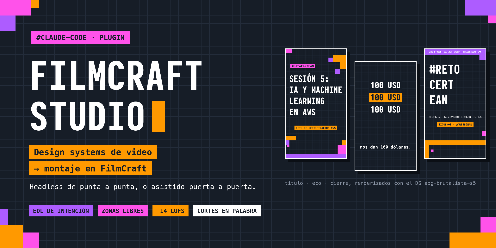
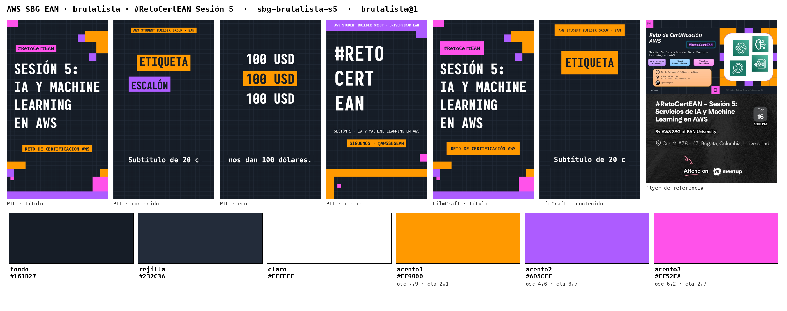
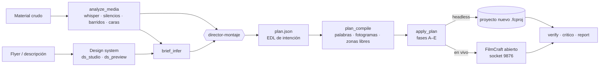

<p align="center">
  
</p>

<p align="center">
  
</p>

<p align="center">
  <b>Plugin de Claude Code que dirige videos de punta a punta: preproducción con biblia y design system, cada escena con su motor, y ensamblado y verificación en <a href="https://github.com/storytold/filmcraft">FilmCraft</a>.</b><br>
  Para material grabado, monta solo (headless) o contigo al lado (asistido, puerta a puerta en la app).
</p>

<p align="center">
  
  
  
  
</p>

---

## Empieza aquí

1. **Instala** el plugin (ver [Instalación](#instalación)) y los requisitos Python: `/filmcraft-studio:doctor` da la orden exacta con la ruta del plugin instalado (desde un clon: `python3 -m pip install -r plugins/filmcraft-studio/requirements.txt`).
2. **Comprueba** el entorno con `/filmcraft-studio:doctor`. Dice qué falta y cómo arreglarlo, y sale con error si falta algo imprescindible:
   - `--para camara` antes de montar material grabado: exige whisper y su modelo (sin esa opción solo se recomiendan);
   - `--para promo` antes de una promo por código: FilmCraft pasa a recomendado y se comprueba VHS;
   - vale cualquier motor (`camara`, `pantalla`, `codigo`, `3d`, `2d`, `montaje`, `audio`, `voz`, `ia`, `promo`), siempre tras `--para`;
   - `--ds <id>` revisa también las fuentes de un estilo.
3. **Haz tu primer video:**
   - algo nuevo, sin material grabado o con varios motores: `/filmcraft-studio:video <qué video quieres>`;
   - una carpeta de material grabado que quieres montar conversando: `/filmcraft-studio:editar <carpeta>`.
4. **¿Con prisa?** Di «exprés» (o pasa `--expres` a la preproducción): una sola ronda de hasta 3 preguntas (idea, plataforma, estilo) con lo inferido como recomendado, un DS del catálogo tal cual y una hoja de 2 fotogramas para aprobar. Se conservan los hechos con fuente, los criterios y la crítica; «tengo referencias» vuelve al flujo completo.

### Qué entrada usar

| Pedido | Entrada | Skill que manda |
|---|---|---|
| «No sé por dónde empezar», «¿tengo todo instalado?» | `/filmcraft-studio:doctor` | — |
| Cualquier video nuevo, sin material o con varios motores (explainer, tutorial, demo, pitch en video, lanzamiento) | `/filmcraft-studio:video` | `director-video` → `preproduccion` |
| Solo decidir el estilo y cerrar la biblia, «tengo referencias», «pregúntame antes» | `/filmcraft-studio:preproduccion` | `preproduccion` |
| Promo de un repo o de una release, sin cámara | `/filmcraft-studio:promo` | `promo-codigo` (tras `preproduccion`) |
| «Hazme un reel de esta charla», resumen de un evento grabado | lenguaje natural | `montaje-headless` o `montaje-asistido` (pregunta cuál, sin biblia larga) |
| «Anima esta imagen», loop de un poster, un solo plano | lenguaje natural | `imagen-a-video` |
| Tengo una carpeta de material grabado y quiero conversar el montaje | `/filmcraft-studio:editar` | `montaje-asistido` o `montaje-headless` |
| Material grabado, sin preguntas | `/filmcraft-studio:montar --modo headless` | `montaje-headless` |
| Material grabado, en la app, bloque a bloque | `/filmcraft-studio:montar --modo asistido` | `montaje-asistido` |
| Tocar un `.fcproj` que ya existe: pulir cortes, color, audio, subtítulos, portar de Premiere o Palmier | lenguaje natural | `editor-filmcraft` |
| Estilos: ver, crear, cambiar, previsualizar | `/filmcraft-studio:ds-listar`, `ds-crear`, `ds-preview` | `design-system-video` |
| Solo el brief de un montaje con material | `/filmcraft-studio:brief` | `brief-video` |
| Cambiar algo de lo ya hecho («el gancho es largo») | `/filmcraft-studio:nota` o lenguaje natural | — |
| Comprobar o exportar («expórtalo») | `/filmcraft-studio:verificar`, `entregar` (este, también en lenguaje natural) | — |

Regla de desempate: `director-video` es la entrada cuando no hay proyecto ni material clasificado; `montaje-*`, cuando hay una carpeta de material de cámara; `editor-filmcraft`, cuando ya existe un `.fcproj` (es oficio, no entrada); `promo-codigo`, para un repo o una release sin cámara; `preproduccion`, antes de producir; `brief-video`, paso interno del montaje; `imagen-a-video`, para un solo plano desde una imagen. Casi todos los comandos solo los lanzas tú; `analizar`, `nota` y `entregar` también los sigue el modelo cuando lo pides en texto (exportar, solo si lo pides).

## Qué hace con material grabado

Le das una carpeta con el material crudo de un evento (videos, voz procesada, fotos y flyer). El plugin:

1. **Escucha y mira** el material: transcribe palabra por palabra con whisper.cpp, mide silencios y energía, detecta los barridos de cámara y localiza caras y personas con Apple Vision. Todo queda en caché.
2. **Elige o crea el estilo**, un *design system de video* (paleta, tipografías, roles de texto, animaciones, transiciones, SFX, música y grade). Lo puede sacar de un flyer por k-means o de una descripción, con vista previa y un ciclo de aprobación.
3. **Completa el brief**: objetivo, público, duración, tono, obligatorios y CTA. Cada campo lleva su origen y su confianza.
4. **Escribe un `plan.json`**, una EDL de *intención* en segundos de la fuente y por roles. Lo hace un subagente director a partir de los momentos que encuentra un subagente analista.
5. **Compila el plan de forma determinista**:
   - bordes ajustados a límite de palabra;
   - tiempos exactos de fotograma;
   - pop-ups colocados en **zonas libres** que no tapan a la gente;
   - subtítulos, barra de marca, SFX ligados a eventos, música con ducking y limitador en el máster.
6. **Lo aplica a FilmCraft** por fases: cortes, audio, textos, transiciones y grade. En headless trabaja sobre un proyecto nuevo; en vivo, por el canal de control de la app abierta.
7. **Verifica antes de enseñar**:
   - hojas de fotogramas con textos y sin ellos, con las caras detectadas;
   - keyframes y cortes en palabra;
   - loudness y pico de la mezcla `.wav`.

   Después pasa un **crítico** y escribe un `informe.md`.

No exporta video salvo que se lo pidas.

## Resultado real

Prueba headless con el material del **#RetoCertEAN · Sesión 5** (AWS Student Builder Group, Universidad EAN). Son 9 grabaciones 4K de un Pixel 8 Pro, comparadas con el reel que se montó a mano:

| | Automático | Manual |
|---|---|---|
| Duración | 53,6 s | 56,7 s |
| Cortes | 23 | 22 |
| Loudness | −14,5 LUFS | −14,7 LUFS |
| Pico real | −1,5 dBTP | −0,1 dBTP |
| Obligatorios cubiertos | 5/5 | 5/5 |

- Ningún corte cae dentro de una palabra.
- Los 241 keyframes están dentro de su rango.
- De 22 pop-ups, ninguno tapa una cara.

Compilar y aplicar el plan tarda unos 4 s; la verificación, menos de 1 min. El veredicto del crítico fue *publicable con arreglos*.

<p align="center">
  
  <br><sub>Vista previa del DS precargado <code>sbg-brutalista-s5</code>: maquetas PIL, dos renders reales de FilmCraft, el flyer de referencia y la paleta con sus contrastes.</sub>
</p>

## Director de video: cualquier tipo de video

La entrada general es `/filmcraft-studio:video <qué quieres>` (skill `director-video`). Sirve para un promo de repo o de una release, un lanzamiento, una demo, un tutorial, un explainer, una entrevista, un short, un pitch, un changelog o un loop para el README (el reel de un evento grabado va directo a `montaje-*`, y animar una sola imagen, a `imagen-a-video`). Todos siguen la misma cadena:

1. **Preproducción** (`/filmcraft-studio:preproduccion`, skill [`preproduccion`](plugins/filmcraft-studio/skills/preproduccion/SKILL.md)). Antes de producir nada:
   - **Preguntas** por rondas (intención, contenido, estilo, movimiento y sonido, producción y entrega), con opciones y una recomendada ([`preguntas.md`](plugins/filmcraft-studio/skills/preproduccion/references/preguntas.md)).
   - **Referencias.** Se mide lo que pasas (`referencias.py`: paleta, cortes por minuto, BPM, loudness) y se lee su filosofía: la regla que genera el aspecto, dónde no actúa y cómo varía, no solo el aspecto ([`referencias.md`](plugins/filmcraft-studio/skills/preproduccion/references/referencias.md)).
   - **Concepto y design system.** El concepto lleva su metáfora. El design system lleva su vocabulario de movimientos y su sonido, con 2–3 direcciones en fotogramas fijos para elegir.
   - **Crítica de originalidad** con el agente `critico-estilo`, contra lo genérico y contra el clon ([`originalidad.md`](plugins/filmcraft-studio/skills/preproduccion/references/originalidad.md)).
   - **Guion** por escenas con motor y herramienta ([`tipos.md`](plugins/filmcraft-studio/skills/director-video/references/tipos.md), [`guion.md`](plugins/filmcraft-studio/skills/director-video/references/guion.md)).
   - **Biblia aprobada** con criterios de aceptación ([`biblia.md`](plugins/filmcraft-studio/skills/preproduccion/references/biblia.md)): el video final se verifica contra ellos.
2. **Herramientas.** `herramientas.py` dice qué hay instalado. [`herramientas.md`](plugins/filmcraft-studio/skills/director-video/references/herramientas.md) cuenta qué herramienta open source cubre cada necesidad y cómo se usa sin interfaz.
3. **Producción por escena**, cada una con su motor ([`motores.md`](plugins/filmcraft-studio/skills/director-video/references/motores.md)):
   - `camara`: material grabado, con análisis;
   - `pantalla`: VHS, OBS, Screen Studio o Cap;
   - `codigo`: render reproducible con Python, Manim, Motion Canvas o HyperFrames;
   - `3d`: Blender sin interfaz con `motor_blender.py`, que usa la paleta, las fuentes y el lienzo del DS;
   - `2d`: Grease Pencil, Synfig o Glaxnimate;
   - `ia`: solo planos de relleno, desde imagen propia;
   - `foto`, `tarjeta`, voz (whisper, TTS local) y música.
4. **Ensamblado en FilmCraft.** Todas las escenas entran como fuentes del mismo `plan.json`; FilmCraft pone los subtítulos, la marca, los SFX, la música con ducking y el grade del DS.
5. **Verificación** con el listón profesional ([`reglas.md`](plugins/filmcraft-studio/skills/director-video/references/reglas.md)), `verify.py`, los criterios de la biblia y los agentes `critico` y `critico-estilo`.

### Promos por código

El motor `codigo` (skill [`promo-codigo`](plugins/filmcraft-studio/skills/promo-codigo/SKILL.md), comando `/filmcraft-studio:promo`) hace promos de un repo o de una release sin cámara:
- la terminal es una **grabación real** con VHS, no una UI inventada;
- cada fotograma se dibuja con Python sobre una rejilla de beats;
- la música y los SFX se sintetizan en esa misma rejilla, sin licencias;
- el máster va a −14 LUFS.

El plugin no trae promos de ejemplo: cada una se escribe en tu carpeta de trabajo con el esqueleto de [`motor.md`](plugins/filmcraft-studio/skills/promo-codigo/references/motor.md) (línea de tiempo en beats, grabación y su medida, contrato de la escena y del audio, `render.sh`, fase 3D y ensamblado en FilmCraft). El estilo sale de un DS `promo-*` del catálogo:

| DS | Gramática | Formato | Firma |
|---|---|---|---|
| `promo-brasa-escarcha` | temperatura@1 | 16:9 | lo que corre es brasa; lo congelado se vuelve escarcha y el grano se para |
| `promo-blueprint` | plano@1 | 16:9 | un plano técnico que se dibuja solo; congelar raya la sección |
| `promo-riso` | riso@1 | 9:16 y 16:9 | dos tintas multiplicadas; congelado = una sola tinta y la cinta frena |
| `promo-gradient-map` | termo@1 | 9:16 | imagen térmica de una impresión mal registrada: la temperatura es del lugar, no de la letra |
| `promo-chispa` | termo@1 | 9:16 | la misma gramática con piel de noche y un solo tono de brasa |
| `promo-tres-fases` | tres-fases@1 | 16:9 y 9:16 | vidrio (Blender) → termo → riso: la materia cambia y el papel se queda |

`/filmcraft-studio:ds-preview <id>` enseña cada uno. Las reglas de cada gramática están en [`gramaticas.md`](plugins/filmcraft-studio/skills/promo-codigo/references/gramaticas.md) y lo aprendido al hacer las primeras promos, en [`aprendido.md`](plugins/filmcraft-studio/skills/promo-codigo/references/aprendido.md): por qué un promo se ve genérico, qué funciona, música y licencias, cómo verificar las afirmaciones y los errores que detecta la hoja de fotogramas.

## Cómo funciona



Un solo motor (`scripts/fcengine.py`) sirve para los dos modos. En headless es una sesión persistente de `filmcraft-cli mcp` que devuelve los ids entre comandos. En vivo usa el canal de control JSON por líneas de la app.

## Instalación

Requisitos (macOS):

- [FilmCraft](https://github.com/storytold/filmcraft) 0.8 o superior, con `filmcraft-cli` en el PATH, o su ruta en `FILMCRAFT_CLI` (por defecto `~/.local/bin/filmcraft-cli`). El puerto del canal de control de la app es `FILMCRAFT_PORT` (9876 por defecto); el MCP `filmcraft` del plugin respeta las dos variables.
- `ffmpeg` y `whisper-cpp` (`brew install ffmpeg whisper-cpp`), más un modelo ggml. Por defecto se usa `ggml-medium.bin`; indica otro con `FILMCRAFT_WHISPER_MODEL`.
- Python 3.9+ con los paquetes de [`requirements.txt`](plugins/filmcraft-studio/requirements.txt): `python3 -m pip install -r plugins/filmcraft-studio/requirements.txt`.
- Opcionales, según el motor: Blender (escenas 3D), VHS (terminal grabada en los promos).
- Xcode Command Line Tools, para compilar `swiftc` y el detector de caras de Apple Vision; no descarga modelos.
- Las fuentes del DS que uses (el precargado pide IosevkaTerm Nerd Font Mono y Menlo).

`/filmcraft-studio:doctor` comprueba todo lo anterior.

En Claude Code:

```text
/plugin marketplace add juan52878911/filmcraft-studio
/plugin install filmcraft-studio@juan-local
```

O desde la terminal, con un clon local:

```bash
claude plugin marketplace add ./filmcraft-studio
claude plugin install filmcraft-studio@juan-local --scope user
```

## Uso

| Comando | Para qué |
|---|---|
| `/filmcraft-studio:doctor [--ds id] [--para motor]` | Comprueba los requisitos y dice cómo arreglar lo que falte |
| `/filmcraft-studio:video <qué video quieres>` | **Entrada general.** Preproducción → producción por motores (FilmCraft, Blender, código, pantalla, 2D, IA) → ensamblado y verificación contra la biblia |
| `/filmcraft-studio:preproduccion <qué video> [--refs …]` | (Skill invocable como comando.) Solo la preproducción: preguntas por rondas, referencias, design system con fotogramas, crítica de originalidad y biblia aprobada |
| `/filmcraft-studio:promo <repo>` | Promo de un repo o de su última versión, renderizado por código con un DS `promo-*` |
| `/filmcraft-studio:editar <carpeta>` | **Montaje de material grabado.** Pregunta qué quieres ver y sigue el orden estilo → intenciones → edición (asistida o automática) |
| `/filmcraft-studio:montar <carpeta> --modo headless` | De punta a punta y sin preguntas. Termina con `informe.md` |
| `/filmcraft-studio:montar <carpeta> --modo asistido` | En la app abierta, con puertas: G1 estilo, G2 brief, G3 estrategia, G4 cada bloque en vivo |
| `/filmcraft-studio:ds-crear <descripción o flyer>` | Crea un design system con vista previa y ciclo de aprobar o modificar |
| `/filmcraft-studio:ds-listar` | Catálogo de estilos con miniaturas |
| `/filmcraft-studio:ds-preview <ds>` | Vista previa de un estilo: maquetas y render real de FilmCraft |
| `/filmcraft-studio:analizar`, `brief`, `verificar`, `nota`, `entregar` | Pasos sueltos: análisis, brief, verificación, aplicar una nota y exportar (solo si lo pides) |

También vale pedirlo en lenguaje natural, por ejemplo: «edita el reel del evento con el estilo del flyer».

## Qué trae

```
AGENTS.md                      guía para Codex, opencode, Gemini CLI y otros agentes fuera de Claude Code
CHANGELOG.md                   qué trae cada versión
plugins/filmcraft-studio/
├── .claude-plugin/          plugin.json e icon.png (fuente: docs/img/icono.svg)
├── .mcp.json                  MCP `filmcraft` (filmcraft-cli mcp; respeta FILMCRAFT_CLI y FILMCRAFT_PORT)
├── requirements.txt           paquetes Python de los scripts
├── skills/
│   ├── director-video/        entrada general: tipos de video, guion por escenas, motores, herramientas, listón profesional
│   ├── preproduccion/         preguntas por rondas, referencias, crítica de originalidad y biblia aprobada
│   ├── promo-codigo/          motor de render por código: esqueleto del motor, gramáticas de promo y lo aprendido
│   ├── editor-filmcraft/      el oficio: criterio de montaje, color, audio, transiciones con la cámara, reglas duras
│   ├── design-system-video/   catálogo y ciclo crear → vista previa → modificar → aprobar
│   ├── brief-video/           intenciones con origen y confianza
│   ├── montaje-headless/      pipeline autónomo y formato de plan.json
│   ├── montaje-asistido/      puertas G0–G7 en la app
│   └── imagen-a-video/        un solo plano animado desde una imagen, sin biblia
├── agents/                    analista-material · director-montaje · critico · critico-estilo
├── commands/                  doctor · video · promo · editar · montar · ds-crear · ds-listar · ds-preview ·
│                              analizar · brief · verificar · nota · entregar  (preproduccion es la skill)
├── scripts/                   fcengine · fclib · fcstyle · plan_compile · apply_plan · verify · report · render_sheet ·
│                              analyze_media · transcribe_fc · camera_motion · vision_detect.swift · freezones · procesar_voz.sh ·
│                              brief_infer · ds_studio · ds_from_image · ds_assets · ds_preview · ds_validate · music_bed ·
│                              promo_fondos · promo_sfx · promo_preview · promo_gradmap ·
│                              herramientas · referencias · motor_blender · blender/{fcblender,titular} · palmier/…
├── schemas/                   JSON Schema de ds, brief, biblia, guion y plan
├── tests/                     pytest sin FilmCraft real (fixtures/ con un guion, una biblia y un plan reales)
└── design-systems/
    ├── sbg-brutalista-s5/     DS de ejemplo completo: fondos, mattes y SFX sintetizados libres de derechos · 9:16
    ├── promo-brasa-escarcha/  temperatura@1 · 16:9
    ├── promo-blueprint/       plano@1 · 16:9
    ├── promo-riso/            riso@1 · 9:16 y 16:9
    ├── promo-gradient-map/    termo@1 · 9:16
    ├── promo-chispa/          termo@1, piel noche y brasa · 9:16
    └── promo-tres-fases/      tres-fases@1 · 16:9, variante 9:16
```

Lo que aprende el plugin sobre las trampas de FilmCraft queda escrito en [`filmcraft-operativa.md`](plugins/filmcraft-studio/skills/editor-filmcraft/references/filmcraft-operativa.md). Algunos ejemplos:

- los keyframes van en ticks de secuencia y la interpolación en tiempo de la fuente;
- las pistas de texto se pasan por índice entero;
- los videos 4K girados necesitan `scaleToFrameSize`;
- los tiempos que caen unos ticks antes del borde de fotograma se bajan al fotograma anterior.

## Esquemas

Los ficheros que pasan de un paso a otro tienen su JSON Schema (2020-12) en [`plugins/filmcraft-studio/schemas/`](plugins/filmcraft-studio/schemas):

| Esquema | Fichero | Quién lo comprueba |
|---|---|---|
| `ds.schema.json` | `design-systems/<id>/ds.json` | `ds_validate.py` (con `jsonschema`), más las referencias cruzadas que el esquema no expresa: rol → pista, rol → SFX del mapa, animaciones definidas, tamaño de los assets y contraste |
| `brief.schema.json` | `brief.json` | los tests; cada campo lleva valor, origen y confianza |
| `biblia.schema.json` | `preproduccion/biblia.json` | los tests; criterios de aceptación contra los que se verifica el video |
| `guion.schema.json` | `guion.json` | los tests; escenas con motor, herramienta y hechos con fuente |
| `plan.schema.json` | `plan.json` | los tests; lo que depende del DS lo comprueba `plan_compile.py` |

```bash
cd plugins/filmcraft-studio
python3 scripts/ds_validate.py --todos          # todos los DS del catálogo
python3 scripts/ds_validate.py <id> --estricto  # uno, con los avisos como errores
```

## Tests

```bash
cd plugins/filmcraft-studio
python3 -m pytest tests -q
```

Corren sin FilmCraft real y sin tocar el catálogo ni la caché del usuario (`CLAUDE_PLUGIN_DATA` apunta a un temporal). Cubren el análisis, la compilación del plan, su aplicación y verificación, los DS y sus esquemas (con un guion, una biblia y un plan reales en `tests/fixtures/`), los generadores de fondos y SFX de promo y `motor_blender.py` (sin Blender). Los que necesitan un paquete opcional (Pillow, jsonschema) se saltan si no está.

## Compatibilidad

| Dónde | Qué funciona |
|---|---|
| **Claude Code** (CLI, Desktop con Claude Code) | Todo: skills, comandos, agentes, MCP `filmcraft` y scripts. Es el destino principal. |
| **Claude.ai / Claude Desktop** (skills subidas) | Sin FilmCraft ni macOS en el servidor: solo tienen sentido `preproduccion`, `brief-video`, `design-system-video` (maquetas PIL) y `promo-codigo` (PIL + numpy + ffmpeg), y solo si se suben con sus scripts. |
| **Codex CLI, opencode, Gemini CLI, Cursor** | Leen [`AGENTS.md`](AGENTS.md): mapa de skills, cómo localizar los scripts con `FILMCRAFT_STUDIO_ROOT` y equivalencias de herramientas (preguntar, enseñar un archivo, subagentes). Los scripts son Python normal y no dependen del arnés. No probado de punta a punta. |
| **Agent SDK** | Cargando el plugin como local; `AskUserQuestion` y `SendUserFile` dependen del host (las skills dicen qué hacer si no están). |

Requisitos de sistema: macOS (Apple Silicon probado en un M4) para el montaje con FilmCraft, Apple Vision (`swiftc`), `open -a FilmCraft` y las rutas de fuentes de `~/Library/Fonts`. El motor de código y Blender no dependen de macOS, pero en Linux no se han probado. Python 3.9+ con [`requirements.txt`](plugins/filmcraft-studio/requirements.txt).

El diseño completo está en [`docs/diseno.md`](docs/diseno.md).

## Referencias de arte

Cada referencia (imagen, captura o fotograma) se convierte en una **ficha de tres capas** validada con `schemas/referencia.schema.json`:

1. **Métricas medibles**, en milisegundos y sin modelos: paleta en OKLCH con proporciones y armonía, temperatura, estructura de valores (clave, notan de 2 y 3 valores), composición (focos por saliencia, tercios/áurea/diagonales, simetría, peso por cuadrantes, espacio negativo, líneas dominantes y horizonte, retícula y márgenes, ritmo), textura y grano, bordes duros/suaves, profundidad aparente y texto. Cada valor lleva objetivo, tolerancia y la palanca para reproducirlo.
2. **Filosofía e intención**, que rellena el modelo mirando la imagen y la hoja: movimiento, emoción, la regla que la genera, qué rompe, qué no copiar y cómo mejorarla.
3. **Traducción a video**: qué se anima, cámara, ritmo y transiciones coherentes con la composición.

```bash
S=plugins/filmcraft-studio/scripts
python3 $S/ref_metricas.py ref.png --ficha ref.json --hoja ref_hoja.png   # ficha + hoja de diagnóstico
python3 $S/referencias.py refs/*.png --out W/referencias                  # fichas + agregado (rasgos comunes vs. propios)
python3 $S/referencias.py --comparar ref.png fotograma.png               # ¿reproduce, mejora o clona?
python3 $S/imagen_a_video.py ref.png --modo parallax --dur 4 --out plano.mp4
```

`--comparar` da la distancia por métrica (estilo y composición) y un veredicto, y se usa en la crítica de originalidad y como criterio de aceptación medible en la biblia. `imagen_a_video.py` anima una imagen fija con cinco modos (`kenburns` por los focos en orden de saliencia, `parallax` 2.5D por capas de profundidad estimadas —motor rígido para piezas gráficas, malla para fotos—, `capas`, `ciclo` sin costura y `revelado` por notan), con grano animado; `--prompt-ia` construye desde la ficha el prompt para Kling/Veo/Runway sin llamar a ninguna API. Guía en `skills/director-video/references/imagen-a-video.md`.

## Créditos

La skill `editor-filmcraft` adapta ideas de tres proyectos MIT: [wonsukchoi/domain-experts](https://github.com/wonsukchoi/domain-experts), [samuelgursky/davinci-resolve-mcp](https://github.com/samuelgursky/davinci-resolve-mcp) y [browser-use/video-use](https://github.com/browser-use/video-use). Las atribuciones completas están en [`NOTICE.md`](plugins/filmcraft-studio/skills/editor-filmcraft/NOTICE.md).

Las recetas propias (estilo brutalista del AWS SBG EAN, gramáticas de promo, transiciones con el movimiento de la cámara, operativa de FilmCraft y scripts) son de Juan Bedoya, escritas junto con Claude.

Licencia [MIT](LICENSE).
